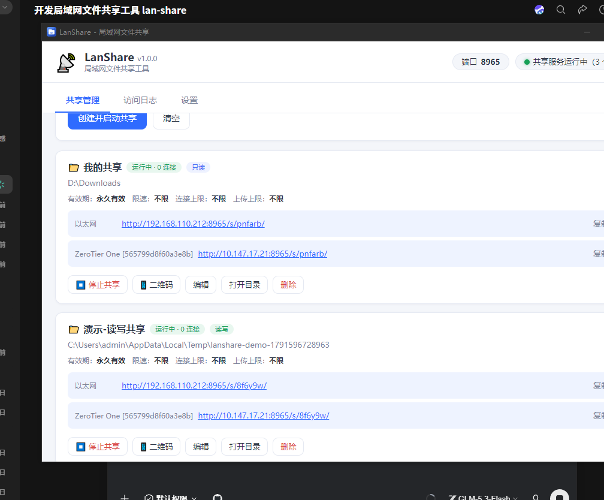
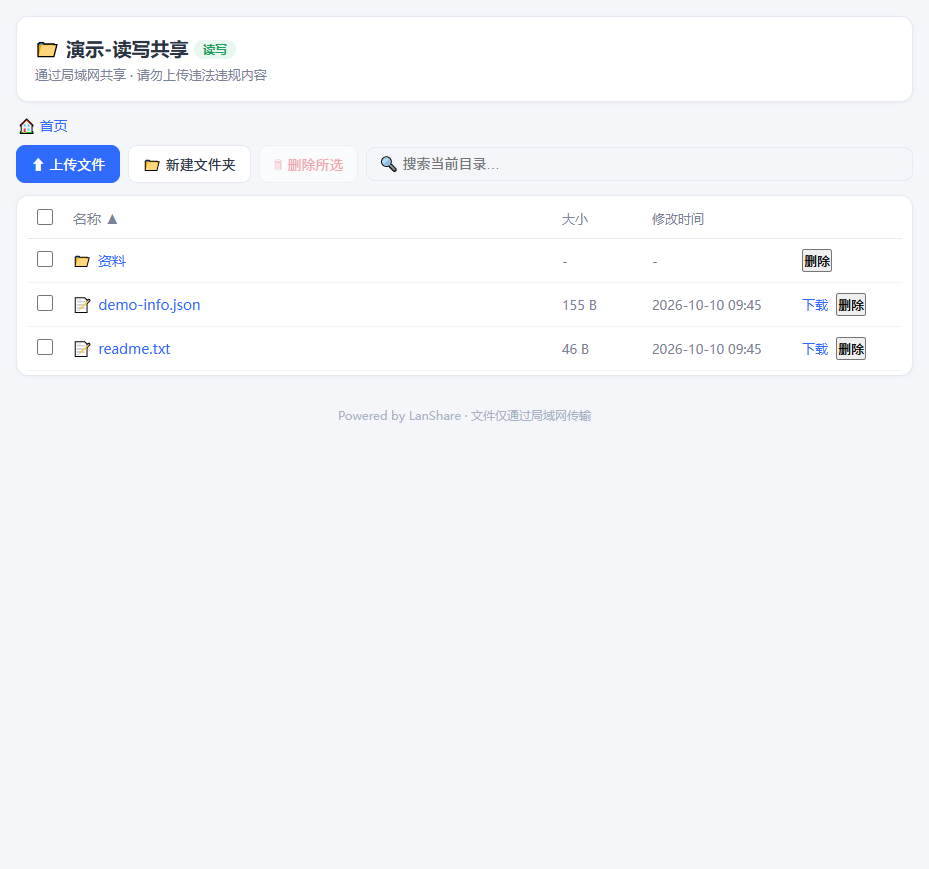

# LanShare — 局域网文件共享工具

一键把电脑上的文件夹或整个磁盘共享给局域网内的手机、平板、其他电脑：**图形界面操作、扫码即连、支持上传下载、密码保护、有效期控制**。Windows 与 macOS 均可用，提供**免安装绿色版**与**安装版**两种形态。

| 主界面（多网卡 IP + 二维码） | 访问端（浏览器 / 手机） |
|---|---|
|  |  |


## 功能特性

| 功能 | 说明 |
|---|---|
| 一键共享 | 图形界面选择文件夹 / 磁盘根目录，设置名称与权限（只读 / 读写），一键启动 / 停止 |
| 连接信息 | 自动列出本机所有局域网 IP、端口与访问链接，生成二维码，手机扫码即连 |
| 密码保护 | 每个共享可设独立访问密码；连续输错 5 次锁定 5 分钟 |
| 有效期 | 支持 30 分钟 ~ 7 天的有效期，到期自动失效并通知 |
| 托盘常驻 | 关闭主窗口不中断共享；托盘菜单可快速启停每个共享、退出程序 |
| 多目录多共享 | 支持多个共享同时运行（各自密码 / 权限 / 有效期）；单个共享可挂载多个目录 |
| 文件访问 | 浏览器目录浏览、下载（支持断点续传 Range）、图片/视频/音频/预览、上传（带进度条、可拖拽）、删除、新建文件夹 |
| 限速 | 每个共享独立上传 / 下载限速（KB/s） |
| 连接数限制 | 每个共享可设最大并发连接数 |
| 访问日志 | 内存 + 磁盘（JSONL 按天）双层日志，界面实时查看、导出 |
| 开机自启 | 安装版支持开机自动启动，并可自动恢复上次运行中的共享 |

## 下载与运行

### 免安装绿色版
1. 下载 `LanShare-x.x.x-win-x64-portable.zip`（Windows）或 `LanShare-x.x.x-mac-*.zip`（macOS）
2. 解压到任意目录，双击 `LanShare.exe`（macOS 为 `LanShare.app`）即可运行
3. 无需安装任何运行环境或依赖

> Windows 首次运行如出现 SmartScreen 提示：点击「更多信息」→「仍要运行」（因程序未做代码签名）。

### 安装版
1. Windows：下载 `LanShare-Setup-x.x.x.exe`，双击安装（支持自定义目录、桌面/开始菜单快捷方式、卸载）
2. macOS：下载 `LanShare-Setup-x.x.x-*.dmg`，打开后将 LanShare 拖入「应用程序」

### 从源码运行（开发）

```bash
npm install
npm start          # 启动应用
npm test           # 服务核心自动化测试（无需 GUI）
```

## 构建与打包

### Windows（生成绿色版 zip + 安装版 exe）

```powershell
# PowerShell
powershell -ExecutionPolicy Bypass -File scripts/build-win.ps1
# 或手动：
npm install
npm run dist:win
```

产物位于 `dist/`：
- `LanShare-x.x.x-win-x64-portable.zip` — 免安装绿色版（解压即用）
- `LanShare-Setup-x.x.x.exe` — 安装版（NSIS 安装向导）

### macOS（生成绿色版 zip + 安装版 dmg）

```bash
bash scripts/build-mac.sh
# 或手动：
npm install
npm run dist:mac
```

产物位于 `dist/`：
- `LanShare-x.x.x-mac-{x64|arm64}-portable.zip` — 免安装绿色版
- `LanShare-Setup-x.x.x-{x64|arm64}.dmg` — 安装版

> macOS 产物需在 macOS 上构建（Apple 限制）；本项目自带 GitHub Actions 配置（`.github/workflows/build.yml`），推送 `v*` 标签即可在云端同时构建 Windows + macOS 产物。

## 使用说明

1. 启动 LanShare，点击「＋ 添加文件夹 / 磁盘」选择要共享的目录（可直接选盘符根目录共享整个磁盘）
2. 设置共享名称、访问权限（只读 / 读写）、密码（可选）、有效期、限速等
3. 点击「创建并启动共享」，列表中会显示所有局域网访问链接
4. 其他设备：
   - 手机：相机 / 微信扫描二维码直接访问
   - 电脑：浏览器打开 `http://<IP>:8965/s/<共享ID>/`
5. 访问页支持目录浏览、搜索、下载、预览；读写共享还支持上传（点击或拖拽）、删除、新建文件夹
6. 关闭主窗口后程序驻留系统托盘，共享不中断；托盘菜单可随时启停共享或退出

## 网络 / 防火墙注意事项

**Windows**
- 首次启动共享时，Windows 防火墙会弹出「是否允许 LanShare 访问网络」，必须勾选「专用网络」并允许（公共网络按需）
- 若错过了弹窗，可手动放行端口（管理员 PowerShell，端口默认 8965）：

```powershell
New-NetFirewallRule -DisplayName "LanShare" -Direction Inbound -Protocol TCP -LocalPort 8965 -Action Allow
```

- 或在「Windows 安全中心 → 防火墙和网络保护 → 允许应用通过防火墙」中勾选 LanShare

**macOS**
- 首次启动时系统弹出「是否允许 LanShare 接受传入网络连接」，选择「允许」
- 若未弹出：系统设置 → 网络 → 防火墙 → 选项 → 添加 LanShare 并允许传入

**其他**
- 访问设备必须与本机处于**同一局域网**（同一路由器 / 交换机下），且路由器未开启「AP 隔离」
- 公司 / 校园网络若启用了客户端隔离，将无法互相访问
- 端口默认 `8965`，可在「设置」中修改；被占用时会自动 +1 重试

## 安全建议

- 只在可信局域网中使用；对外共享建议**只读 + 密码 + 短有效期**
- 读写共享允许访问者上传、删除文件，请谨慎开启
- 程序已做路径穿越防护，访问范围严格限制在共享目录内
- 访问日志可帮助排查异常访问
- 本工具不向互联网暴露端口，请勿手动将端口映射到公网

## 常见问题

**Q：手机扫二维码打不开？**
检查手机与电脑是否在同一 Wi-Fi / 局域网；检查防火墙是否放行；尝试访问界面中另一个网卡的链接（部分电脑有多个网卡 / 虚拟网卡）。

**Q：上传失败提示 403？**
该共享为只读权限，需在主界面编辑共享改为「读写」。

**Q：下载大文件中途断了怎么办？**
访问页支持 HTTP Range 断点续传，浏览器或下载工具会自动续传。

**Q：绿色版能开机自启吗？**
可以，但依赖解压路径固定；路径变化后请重新开关一次「开机自启」开关。安装版无此问题。

**Q：如何彻底退出？**
系统托盘图标 → 右键 → 退出 LanShare。直接关闭主窗口只会隐藏窗口。

## 技术架构

```
src/
├── server/          # 共享服务核心（纯 Node，无 Electron 依赖，可独立测试）
│   ├── hub.js       #   共享中心：路由 / 认证 / 会话 / 过期 / 限流 / 日志
│   ├── listing.js   #   访问端页面（目录浏览 / 登录 / 上传下载，零外部依赖）
│   ├── throttle.js  #   令牌桶限速流
│   └── mime.js      #   MIME 识别
├── main/            # Electron 主进程：窗口 / 托盘 / IPC / 配置持久化
└── renderer/        # 主窗口界面（原生 HTML/CSS/JS）
```

- 运行时依赖仅 `qrcode`（纯 JS）；HTTP 服务、限速、认证、限流均为原生实现
- 单端口承载多共享（`/s/<shareId>/`），防火墙只需放行一次
- 服务核心与 UI 分离，`npm run test:server` 可在无 GUI 环境完整回归（50+ 断言）

## License

MIT
